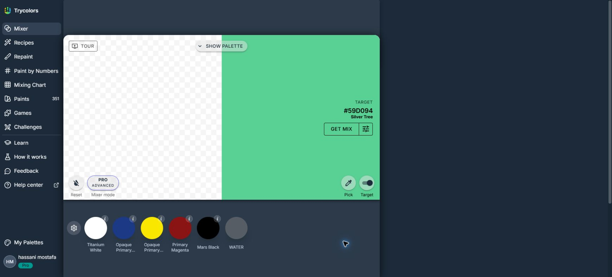
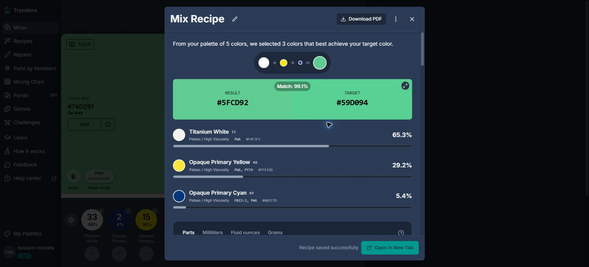
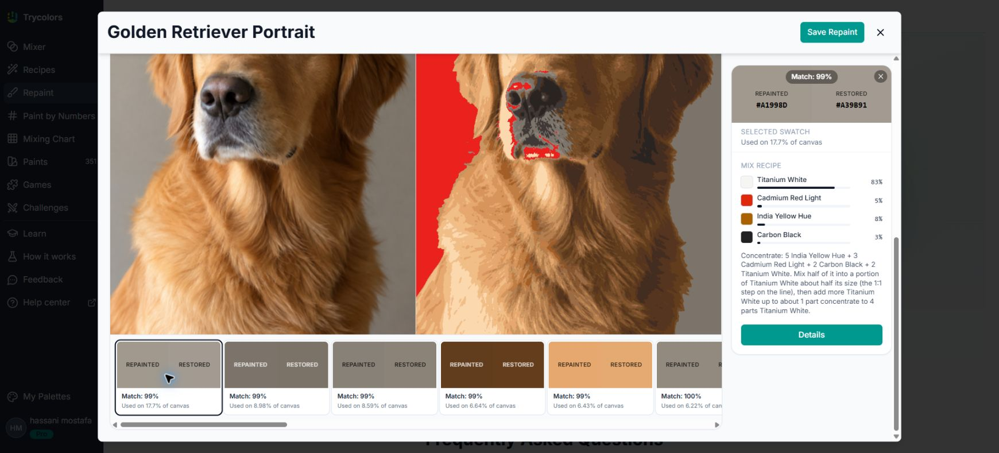
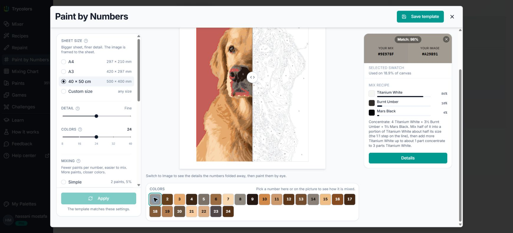
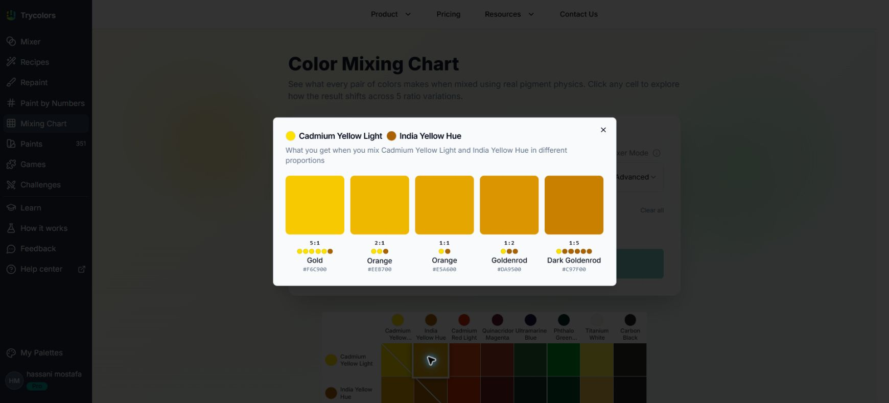
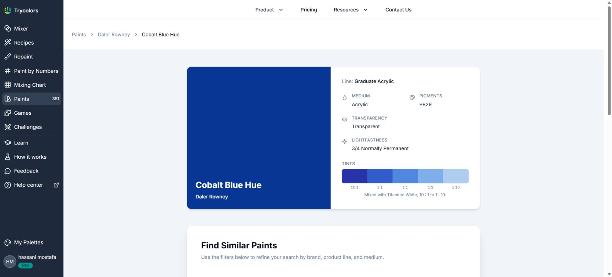
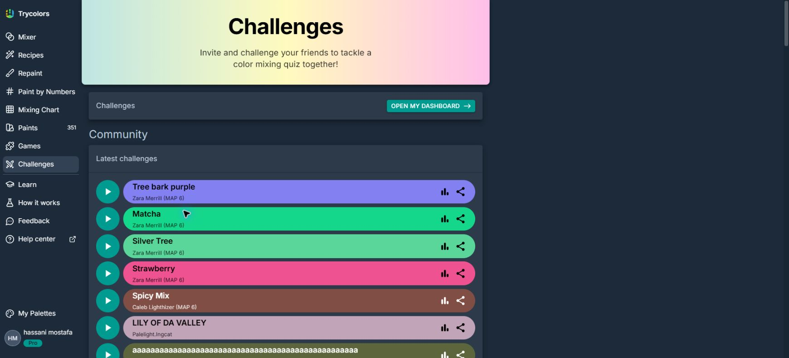
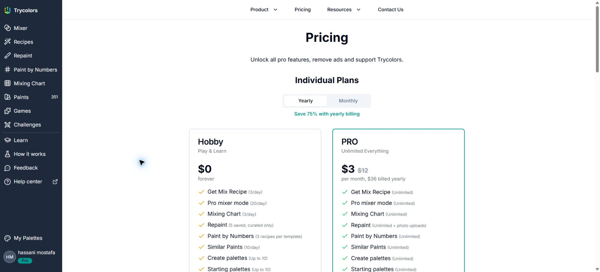
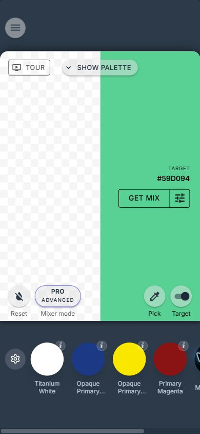
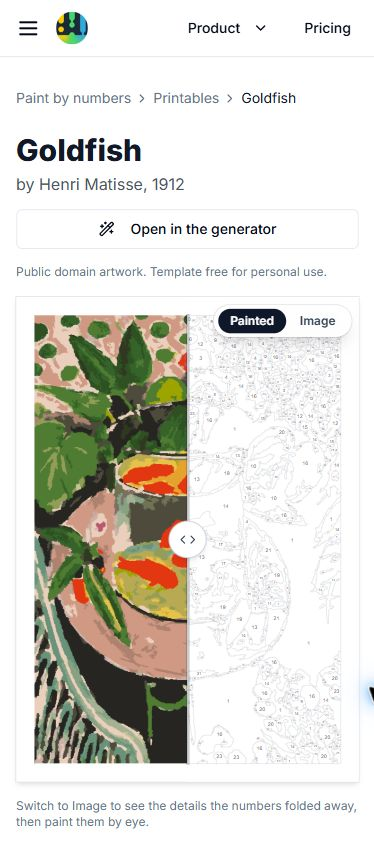

# Trycolors — detailed feature audit and product analysis

**Website:** https://trycolors.com/  
**Audit date:** 15 October 2026, UTC  
**Environment:** Chrome desktop; existing signed-in Pro session; desktop viewport approximately 1740 × 789; mobile viewport emulation 390 × 844.  
**Deliverables:** this report, an HTML reading copy, and 11 screenshots in the accompanying screenshots folder.

## 1. Executive assessment

Trycolors is a connected painting toolkit built around a practical question: which of the paints I own should I mix, and in what amounts? Its principal products are a manual mixer, target-color recipe solver, photo repainting workspace, paint-by-numbers generator, pairwise mixing chart, and searchable paint catalog. Learning content, games, public palettes, challenges, classroom access, widgets, and an API surround those tools.

The strongest product idea is continuity. Users can move from an image or target color to a paint recipe, then to instructions for physically mixing it. Paint-by-numbers extends this into a complete painting activity: the number identifies both a region and a reproducible recipe. This makes the service useful after the initial conversion, while someone is actually painting.

The main weaknesses observed are uneven interaction design between older and newer pages, insufficiently named controls, small secondary targets on mobile, unclear persistence in the recipe flow, and inconsistencies between current features and older documentation. Match percentages also need careful interpretation: a highly rated calculated recipe can become considerably less accurate when rounded into practical parts.

For Darl’Art, the best immediate opportunities are an interactive painting guide, color-region selection, original/painted/template comparison, stronger print guidance, and saved project access. Reproducing a physical pigment-mixing engine is a different and much larger undertaking than the existing nearest-paint palette matching in this repository.

## 2. Scope, evidence, and confidence

This is a broad product and interface audit of the site's discoverable feature families. It is not a source-code review, penetration test, laboratory validation, or exhaustive certification of every account state and feature combination.

Evidence labels used throughout:

| Label | Meaning |
|---|---|
| Tested | A control was exercised and the resulting state was observed. |
| Inspected | The live interface, available settings, or output was read without completing every action. |
| Documented | The vendor's public explanation or pricing page states the capability. |
| Unverified | Not completed, not measurable here, or dependent on an untested state. |
| Analysis | Auditor interpretation or a suggested improvement. |

Testing used the site's own example images. No personal photos were uploaded, purchases made, messages sent, API keys generated, or existing palettes/templates edited or deleted. One Get Mix test **automatically created a saved recipe** in the existing account. The result displayed a save-success message, and the recipe appeared in My Recipes. This was an observed side effect of calculation, not a separately selected Save action. It was left intact.

The initial read-only repository exploration supplied context for the Darl’Art comparison. No application source was modified for this audit.

## 3. Information architecture and feature inventory

| Area | Entry point | Main capability | Coverage |
|---|---|---|---|
| Home | [Homepage](https://trycolors.com/) | Product introduction, working tool demos, testimonials, educational/business paths, FAQs | Inspected; one FAQ expanded |
| Manual mixing | [Mixer](https://trycolors.com/mixer) | Add paint parts, compare with target, calculate mix, choose engine and starting palette | Tested |
| Recipe solver | [Recipes / Unmixer](https://trycolors.com/unmixer) | Target color plus available paints → calculated proportions and practical guide | Tested from mixer; dedicated form inspected |
| Color picker | Recipes and mixer | HSV/HEX entry, photo sampling, catalog paints | HSV and Photo tabs inspected; no upload |
| Repaint | [Repaint](https://trycolors.com/repaint) | Recreate an image using mixtures of a limited starting palette | Built-in retriever example tested |
| Paint by Numbers | [Generator](https://trycolors.com/paint-by-numbers) | Numbered regions, sheet/detail/color/mixing settings, recipes | Built-in retriever example tested |
| Free printables | [Goldfish example](https://trycolors.com/paint-by-numbers/printables/goldfish) | Public template preview, recipes, print file and painting guide | Desktop and mobile inspected; color selection tested |
| Mixing matrix | [Mixing Chart](https://trycolors.com/color-mixing-chart) | All pairwise combinations; five ratio variations per pair | Default chart and one cell tested |
| Paint library | [Paints](https://trycolors.com/paints) | Search by color/text, brand/line and medium; paint detail pages | Color search and one detail tested |
| Palettes | [Community palettes](https://trycolors.com/palettes) | Browse shared collections; access palette detail/share actions | Listing inspected |
| Starting palettes | Mixer settings | Default collections plus account palettes; create/edit choices | Selection modal inspected; no changes saved |
| Games | [Games](https://trycolors.com/games) | Guess Mix, Guess Color, and a 40-level campaign | Catalog and Guess Mix entry inspected |
| Challenges | [Challenges](https://trycolors.com/challenges) | Community quizzes, sharing, dashboards, statistics and rankings | Public listing inspected |
| Learning | [Learn](https://trycolors.com/learn) | Color-specific tutorials and famous-painting palette studies | Index inspected |
| Science | [How it works](https://trycolors.com/how-it-works) | Pigment model, measurement process, claimed validation | Public explanation inspected |
| Help | [Documentation](https://docs.trycolors.com/) | Search, mixer/account/widget/API guidance | Index and selected mixer pages inspected |
| Commercial | [Pricing](https://trycolors.com/about/pricing) | Hobby, Pro, Classroom, Business | Annual and monthly tab tested |
| Embeds | [Widgets](https://trycolors.com/product/widgets) | Configurable tools embedded on another site | Product page inspected |
| Developer API | [API product](https://trycolors.com/product/api) | Mix, unmix, similar-paint operations and quotas | Public page inspected; no authenticated call |
| Education | [Classroom](https://trycolors.com/use-cases/e-learning) | Pro access for a class; manual student onboarding | Public workflow inspected |
| Support/privacy | [Contact](https://trycolors.com/about/contacts), [Privacy](https://trycolors.com/about/privacy-policy) | Support form, policy disclosures | Read only; no submission |

The primary sidebar keeps most tools visible on desktop. A top navigation layer serves product, pricing, resources, and contact links. Footer navigation exposes community palettes and business pages. Mobile collapses navigation. The naming difference between “Recipes” in navigation and “Unmixer” in URLs and some page copy adds a small vocabulary burden.

## 4. Manual mixer and engine configuration

### 4.1 Main workflow

The mixer presents the current mix beside an optional target. Paint swatches sit beneath the canvas. Adding a paint increments its count and updates percentage shares. The interface also exposes decrement controls for used paints, reset, target visibility, color picking, Get Mix, a tour, and a palette panel.

**Test:** one part Titanium White plus one part Opaque Primary Yellow from the existing five-paint starting palette. Both read 50%; after the mixing state completed, the resulting color was **#FCED6F**, named Festival, with a displayed **71%** match to the target **#59D094**.

The first intermediate state still displayed the previous white result alongside a Mixing status before the new value appeared. That is not proof of a calculation error, but dependent values should ideally remain visibly pending until they are internally consistent.

### 4.2 Mixing engines

The live configuration modal exposes three engines:

| Engine | On-screen positioning |
|---|---|
| Basic | Fast RGB-based mixing, usable with arbitrary colors |
| PRO Fast | Plausible fast approximation; may need tinting-strength calibration |
| PRO Advanced | Newer option based on measured real pigments |

The modal includes a comparison demo and explanatory FAQs. PRO Advanced was already selected; no engine changes were saved. A water swatch was visible, but its dilution/opacity behavior was not exercised.

**Documented:** tinting strength can be calibrated for custom starting palettes. The older help article describes a 1–100 adjustment scale, uniform/adjusted comparisons, and calibration by comparing virtual and physical two-paint mixes. This is not proof that all historical controls remain identical in the current Advanced engine.

### 4.3 Starting and output palettes

The current starting-palette menu offers edit, select another palette, and create new palette. The selection dialog includes search, default Basic (5), Essential (8), Advanced (10), and Classic legacy (8) collections, plus custom account palettes. No selection was changed.

The output palette panel initially displayed an unsaved state with Create and further actions disabled until it contains usable output. Documentation describes adding mixed colors, renaming/reordering/removing colors, editing individual colors, and sharing palettes. Palette creation and deletion were intentionally not executed.

**Assessment:** direct paint addition is easy to understand visually. The less successful aspect is discoverability: the gear, pick tool, reset control, and several swatch buttons lack meaningful names in the accessibility tree. Descriptive paint text often exists next to the button without naming the button itself.

## 5. Recipe solver, scaling, and practical instructions

### 5.1 Inputs and calculation

The dedicated Recipes page has a target-color selector, starting palette, maximum ingredient count, engine selection, and a Get Mix action. A saved-recipe list appears for the signed-in account. The color picker exposes HSV, Photo, and Paints tabs. The HSV view includes a format selector currently showing HEX, a text input, hue/color controls, and current/new comparison. The Photo view exposes access to the photo collection; actual upload, camera use, and image sampling were not tested.

**Test:** Get Mix in the mixer for **#59D094**, using the existing five-paint palette and Advanced mode. The solver selected three paints and returned:

| Paint | Percentage displayed |
|---|---:|
| Titanium White | 65.3% |
| Opaque Primary Yellow | 29.2% |
| Opaque Primary Cyan | 5.4% |

The result was **#5FCD92**, with **99.1%** displayed match. Small percentage-sum differences are consistent with display rounding. These are the service's simulated results, not independently measured physical paint accuracy.

### 5.2 Scaling and rounding

The results dialog provides Parts, Milliliters, Fluid ounces, and Grams, plus total-amount choices. Parts offered totals of 10, 20, 50, and 100. Switching to milliliters was tested and changed the guide to approximately **32.6 ml white + 14.6 ml yellow + 2.7 ml cyan** for the displayed total.

An important test finding: the initial results modal's **50-part** version showed **33 white + 15 yellow + 2 cyan**. Its predicted result was **#00BC9D**, with **90.2%** match, materially below the 99.1% headline result. The separate practical-use guide showed **#59CB90 / 98.8%**. The milliliter guide showed **#5FCC92 / 98.8%**.

**Follow-up verification:** reopening the saved recipe in its standalone page produced **32 white + 15 yellow + 3 cyan**, with **#58CA91 / 98.5%** after calculation settled. The low-score 33/15/2 state therefore was not reproduced on the standalone page. Treat this as an observed inconsistency between the initial modal state and the reopened recipe, and investigate rounding/state synchronization before assuming a universal solver defect. Both results were seen in the same audit session.

This demonstrates why ingredient potency and rounding matter. A small change in a strong pigment can meaningfully change the simulated outcome. The interface does disclose that fewer parts are easier to measure but less exact. It should also make the **chosen practical recipe's score** the most prominent score at the point of use.

### 5.3 Instructional depth

The recipe view includes full-screen swatches, sequential mixing, a progress animation, base/concentrate instructions, a white-card screen-brightness check, wet versus dry appearance, ratio-ladder comparison, and adjustment-by-eye choices. It also offers PDF download and a separate-tab view, with a feedback prompt.

The three-paint example advised making a generous white/yellow base, keeping part aside, and adding small amounts of cyan to the remainder. It provided multiple cyan-to-base comparison ratios and a highlighted stopping point. This is unusually useful teaching content because it addresses how a person mixes paint with imperfect measurement.

**Persistence:** calculation automatically saved a recipe. This should be communicated before or beside Get Mix, especially for users expecting a temporary experiment. PDF export was visible but not completed.

## 6. Repaint: limited-palette image reconstruction

### 6.1 Input and result

Repaint accepts a reference image and a starting palette. Four built-in examples were available: Golden Retriever Portrait, Goldfish, Starry Night, and The Pine Tree at St. Tropez. Photo upload becomes available after the signed-in state finishes loading.

**Test:** Golden Retriever Portrait with the default Essential eight-paint palette. The tool opened a workspace with a rendering state, then a completed side-by-side view. It used all eight starting paints and generated 20 output colors. This distinction matters: **starting paints are ingredients; output colors are mixtures**, so they are not the same count.

### 6.2 Result controls

Observed controls include:

- Original and Restored source views, alongside Repainted output.
- A color-count slider, zoom slider, and pan/pinch instructions.
- Ingredient-paint usage percentages and remove-paint actions.
- A details expansion and a Save Repaint action.
- Clickable output swatches with HEX values, match percentages, and canvas-area share.
- A selected-color recipe pane and a Details action.

**Tested swatch:** #A1998D occupied **17.7%** of the canvas and displayed **99%** match against restored #A39B91. Its recipe read approximately 83% Titanium White, 5% Cadmium Red Light, 8% India Yellow Hue, and 3% Carbon Black, followed by concentrate/base instructions.

The result's source reconstruction and its paint approximation are presented separately, which helps users understand both image simplification and paint limitations. More explicit short definitions at the tabs would reduce the need to consult FAQs.

The FAQ advertises recalculate behavior, sharing, locked recipes on shared results, and suggestions to add a paint for a closer match. These secondary paths were not exercised. The preview was not explicitly saved.

## 7. Paint-by-numbers generator and printable workflow

### 7.1 Positioning and inputs

This feature targets people who want to paint from their own tubes rather than depend on a kit's prefilled pots. It offers example images or upload, starter selections for Liquitex Basics, Winsor & Newton Galeria, Amsterdam, Golden, and an other-paints path. Users can exclude individual paints they do not own.

The key product distinction is that **a numbered color is linked to a mixing recipe**. Its value extends beyond printing an outline.

### 7.2 Settings observed in the generated workspace

| Setting | Observed options / behavior |
|---|---|
| Sheet size | A4, A3, 40 × 50 cm, Custom |
| Custom units | Millimeters or inches |
| Custom bounds | Each side 100–2000 mm, as displayed |
| Detail | Slider; example displayed Fine |
| Output colors | Slider with visible ticks at 8, 16, 24, 32, 40 |
| Mixing complexity | Simple: 2 paints and 5% notation; Medium: 3 paints; Hard: 4 paints |
| Ingredient selection | Starter sets plus per-tube checkbox exclusions |
| Apply | Disabled when current; enabled after changing custom size selection |

Color-count ticks are observed UI values, not proof of every allowed intermediate value. Custom-size selection and the resulting width/height controls were tested; the changed settings were not applied to rebuild the example.

### 7.3 Preview and recipe selection

**Test:** generate the Golden Retriever example with the initially selected settings. The finished workspace displayed a 24-color preview, outline/template comparison slider, Painted and Image choices, a numbered color strip, paint usage, and a recipe pane.

Selecting **number 1** opened its recipe: **#9E978F** simulated mix versus **#A29B91** image color, **98%** match, and **18.9%** canvas area. The ingredients were 86% Titanium White, 10% Burnt Umber, and 4% Mars Black. A practical concentrate instruction and Details action followed.

The site describes selecting all regions of a number and tapping the picture to identify a number. Number-strip selection and recipe retrieval were tested. Pixel-level correctness of every highlighted region and direct canvas hit testing were not independently verified.

**Usability:** the desktop modal is information-rich but uses several independent scroll areas for settings, preview, and recipes. It demands more spatial attention than a staged workflow. Keeping sheet/detail settings collapsible after generation would give more room to painting and recipe inspection.

### 7.4 Free printable library

Eight templates were advertised on the generator landing page, including Goldfish, The Magpie, Golden Retriever, Highland Cow, Lemon Terrace, Harbour Sunset, Covered Bridge, and Winter Cabin.

The **Goldfish** page listed A3, 24 colors, 1,400 regions, Fine detail, Medium mixing complexity, and 11 used tubes from the Liquitex Basics 12-tube set. It provided source attribution and a personal-use statement. Do not infer a blanket commercial license for templates from the underlying artwork's public-domain status.

The page includes the interactive painted/template comparison, numbered recipes, separate **print-file** and **painting-guide** download actions, printing instructions, suggested materials, and external retailer searches for supplies. It also links back into the generator to customize the example.

**Download limitation:** a print-file download attempt did not produce a retrievable file through browser automation and stalled the download wait. This is an inconclusive automation result, not proof that the website's download is broken. PDF page count, dimensions, vectors, embedded fonts, line legibility, and printing at actual scale remain unverified.

**Mobile:** the public printable uses a single-column layout at 390 × 844. The image comparison and numbered color selection worked. Selecting number 1 displayed 98% match and a recipe using Primary Yellow, Cadmium Orange Hue, and Mars Black. This tested the public viewer, not the generator modal on a physical phone.

## 8. Mixing chart

The mixing chart turns a selected starting palette into a pairwise matrix. The default Essential eight-color chart displayed symmetric off-diagonal results and descriptive names/HEX values on cells. The page offers an engine selector, color selection, clear-all, and Generate Chart.

**Tested cell:** Cadmium Yellow Light with India Yellow Hue. A detail dialog showed five proportions:

| Ratio | Result HEX |
|---|---|
| 5:1 | #F6C900 |
| 2:1 | #EEB700 |
| 1:1 | #E5A600 |
| 1:2 | #DA9500 |
| 1:5 | #C97F00 |

This gives a fast visual understanding of a palette's range. The chart FAQ references a 12-color limit. The limit was not stress-tested. Large matrices should preserve clear row/column context and offer a compact export or triangular view to avoid redundant scanning.

## 9. Paint catalog and matching

### 9.1 Discovery

The catalog offers color and text search modes, brand/product-line selection, medium filters, popular brands, and lists organized by medium. Mediums include acrylic, oil, watercolor, gouache, model painting, home decor, pencils, pastels, pigments, inks, and others.

Counts vary across pages: the current sidebar displays **351** beside Paints, homepage copy mentions **250+ brands**, and the older documentation introduction mentions **200+ brands / 200,000+ colors**. These may reflect different dates or definitions. They should not be treated as a precise verified count of measured physical paints.

**Test:** search the default blue **#073694** across all brands and mediums. The search opened a URL preserving the color, threshold, and page, with 20 visible result links and **159 pages** indicated. The first result was Daler Rowney Graduate Acrylic Cobalt Blue Hue. Because no medium filter was applied, results included different media, such as paint and pencils.

### 9.2 Detail page

The Cobalt Blue Hue page exposed:

- Brand and product line.
- Acrylic medium; pigment PB29; transparent classification.
- Lightfastness displayed as 3/4, Normally Permanent.
- A five-step titanium-white tint series, from 10:1 to 1:10.
- Similar-paint search with brand/line and medium filters.
- Copyable HEX, RGB, HSV, HSL, CIE LAB, and CMYK values.

The page is a useful bridge between a screen swatch and a recognizable tube. However, RGB-derived CMYK values are not a substitute for a press profile, and catalog proximity does not guarantee matching opacity, texture, tinting strength, or physical mixing behavior. The interface could better distinguish “close appearance” from “compatible replacement.”

## 10. Palettes, games, challenges, and learning

### 10.1 Palette ecosystem

The public palette listing has named collections, preview links, sharing menus, and pagination reaching page 2,662 at inspection. This indicates a large browsable archive, not a measured total of unique or useful palettes. Search, sort, and quality curation were not evident in the inspected listing snapshot.

Documentation describes custom palette editing, color sampling from photos, catalog selection, reordering, renaming, and automatic persistence after editing. The homepage FAQ claims CSV color import and palette/mix exports to images and design-software-compatible formats. Exact schemas and supported application formats were not verified by import/export execution.

### 10.2 Games

| Game | Observed description | Tested extent |
|---|---|---|
| Guess Mix | Recreate a random target by adding paints; Easy/Normal/Hard; match scoring | Opened game entry; difficulty controls and statistics labels inspected |
| Guess Color | Choose one of four predicted mixtures within 15 seconds | Catalog description only |
| Guess Mix campaign | 40 authored levels | Catalog description only |

A Resume button was present on the Guess Mix entry. No existing game was resumed and no scored round was submitted, to avoid altering the user's statistics. Catalog badges use Hobby, Pro, and App terms; precise current entitlement behavior was not verified.

### 10.3 Challenges and community quality

Challenges exposes public user-created color quizzes, individual links, share menus, statistics links, a personal-dashboard entry, and ranked user lists. This supports invitation, practice, and repeat use.

The inspected latest-challenges feed contained repetitive low-information names and at least one title referring to domestic violence. This is evidence of a curation concern for a classroom-facing product, not proof that no moderation exists. A curated school mode, reporting controls, and separation of teacher-approved content from the open feed would be valuable.

### 10.4 Learning and support

Learn organizes material around specific color goals, including peach, olive, brown, teal, pink, orange, forest green, grey, black, beige, coral, sage, and lavender. Famous-painting studies show sampled colors with multiple starter-palette approaches. This creates a strong search-to-tool path: an instructional query can lead directly to a mixing exercise.

The help center offers documentation search, a table of contents, mixer topics, account access/settings, subscription guidance, widget configuration, installation, API authentication, endpoint guidance, and rate-limit pages. Several inspected help pages are dated **17 September 2024** and do not fully reflect the newer feature set.

Contact has name, email, and message fields with an initially disabled Send button and a message-minimum hint. The form was not submitted; validation messaging and delivery were not tested.

## 11. Pricing, limits, education, and integrations

### 11.1 Plans observed

These are displayed USD prices and public entitlements on the audit date, not a checkout quote. Tax, regional currency, actual billing, cancellation, refund handling, and enforcement were not tested.

| Plan | Price displayed | Main positioning |
|---|---|---|
| Hobby | $0 | Limited free tools |
| Pro annual | $3/month equivalent; $36 billed yearly | Unlimited individual tool use; annual tab showed 75% saving versus $12/month |
| Pro monthly | $12/month | Monthly individual subscription |
| Classroom | $29/month, up to 30 students | Pro for the teacher/class; no student ads |
| Business | Starting from $30/month; custom pricing | Widgets, higher API limits, custom brand/support work |

Hobby limits shown: 3 mix recipes/day; 20 Pro-mixer uses/day; 3 mixing charts/day; Repaint with 5 saved projects and curated palettes only; 3 recipes per generated PBN template; 10 similar-paint searches/day; up to 10 output palettes and 10 starting palettes; and 20 tinting-strength uses/day.

Pro is presented as unlimited for the corresponding personal tools, including Repaint photo uploads. This does **not** mean unlimited API calls or embedded widget traffic. Free printables are promoted with every recipe included; generated personal templates have a separate free-tier three-recipe limit. That distinction needs to remain prominent.

### 11.2 Classroom workflow

The public classroom page describes monthly purchase by a teacher, followed by email setup within one business day. Students create free accounts and the provider unlocks Pro. This is a service-assisted onboarding flow; an instant self-service roster, teacher dashboard, assignment tracking, SSO, and grading system were not demonstrated.

The page advertises a model covering 61 pigments and support for phones, tablets, laptops, and Chromebooks. Those are vendor statements, not an independently verified pigment inventory or device test matrix.

### 11.3 Widgets

Widgets are advertised for recipes, similar paints, games, and mixer configuration. The setup path is sign in → configure in a playground → embed code → increase capacity if required. The public product page says Hobby and Pro include **100 widget loads/month**. No widget was installed on another site, no settings were saved, and cross-origin behavior was not tested.

### 11.4 API

The API page shows JSON POST usage, an X-API-KEY header, and an example mix-colors endpoint. It describes mix, unmix, and similar-paint operations.

| Operation | Hobby/Pro requests/sec | Hobby/Pro daily | Business Tier 1 requests/sec | Business Tier 1 daily |
|---|---:|---:|---:|---:|
| Mix colors | 2 | 50 | 10 | 2,000 |
| Unmix color | 1 | 10 | 5 | 1,000 |
| Similar paints | 1 | 10 | 5 | 1,000 |

No authenticated API calls were made. Do not assume the public API exposes the complete Repaint or PBN pipeline: that was not established by the inspected product page. For Darl’Art, key questions before integration are calibrated paint support, recipe units, commercial rights, data retention, API versioning, and workload costs.

## 12. Science, accuracy, and trust

The science page describes a two-constant Kubelka–Munk model, wavelength-dependent absorption/scattering, spectrophotometer measurements, titanium-white tint ladders, and prediction checking against physical mixtures. It states measurements across 400–700 nm at 10 nm intervals, D65 illumination, weighed mixtures, and approximately ΔE 3 performance on measured examples.

These are useful and concrete disclosures. They are **vendor-reported results**, not an independent validation performed in this audit. The fact that the catalog contains many colors does not establish that every listed paint has independently measured spectral coefficients. The classroom page's 61-pigment claim further reinforces the need to separate catalog breadth from calibrated-model coverage.

A match percentage should be understood as a digital similarity indicator under the site's model. Screen calibration, lighting, paint batch, substrate, thickness, wet/dry shift, ingredient strength, and measurement error can change the physical result. The practical guides address some of these through white-card checks and dried-swatch comparisons. Publishing model coverage and error ranges per paint would improve confidence further.

### Privacy communication

The PBN upload tooltip says unsaved images are deleted within 48 hours. The privacy policy says uploaded images are retained until deleted in the app or with account deletion and may be reviewed internally to improve the service. It also says images are not sold or shared with third parties, while broader policy sections discuss service providers and other data-sharing categories.

These statements may refer to different saved/unsaved image classes, but that distinction is not clearly reconciled in the inspected policy. The recommendation is a plain retention table: temporary upload, saved photo, saved project, deletion request, and backup retention. No backend deletion or retention behavior was tested. This is a communication finding, not a legal-compliance determination.

## 13. Design, accessibility, responsive behavior, and technical observations

### 13.1 What works

- Newer tool pages use numbered input stages, clear example content, and visible rendering states.
- Color recipes are supported by text, quantities, identifiers, and comparisons rather than color alone.
- Dialogs use explicit headings; many modern controls expose radio, checkbox, slider, tab, and dialog semantics.
- Numbered PBN swatches have descriptive accessible labels explaining their action.
- Printable pages connect preparation, printing, materials, and painting guidance in one workflow.

### 13.2 Visual consistency and hierarchy

Older mixer/games/community views use dark blue surfaces and a relatively narrow workspace on a wide desktop. Newer generation pages and dialogs use light surfaces, rounded panels, and denser guidance. The shared sidebar helps orientation, but the change in visual language makes the service feel assembled in generations.

The PBN workspace has strong functional grouping, but the preview can feel constrained by settings and recipe panes. The homepage includes multiple working tools and substantial marketing content; that is a good demonstration strategy but increases page length and interaction density. A short task selector could route first-time users more directly.

### 13.3 Accessibility observations

| Observation | Evidence | Implication |
|---|---|---|
| Unnamed paint-add controls | Mixer accessibility tree reports empty button names; paint names are adjacent text | Screen-reader users may not know which paint an empty button adds |
| Generic target toggle | Accessible name reported as primary checkbox | Purpose and state need a meaningful name |
| Unnamed configuration/actions | Gear, several icon buttons, and some chart selection controls lack descriptive names in snapshots | Discoverability and assistive use suffer |
| Small information controls | Mixer paint-detail buttons measured 20 × 20 CSS pixels at mobile width | Need larger hit areas or sufficient spacing; WCAG conformance depends on exceptions and layout |
| Legacy duplicate IDs | Mixer FAQ buttons repeatedly expose panel1a-header | Potentially ambiguous relationships; verify DOM references and assistive behavior |
| Weak game-card semantics | Game entry visuals were not exposed as clear links/buttons in the initial tree; coordinate click opened Guess Mix | Keyboard and assistive navigation need direct testing |

No complete keyboard traversal, screen-reader session, contrast-ratio audit, reduced-motion test, high-zoom audit, or WCAG certification was completed. Small grey labels and faint printable lines warrant measurements, but this report does not label them contrast failures without those measurements.

### 13.4 Mobile tests

At 390 × 844, the mixer document width was **390 pixels**, matching the viewport: no whole-page horizontal overflow was measured. Its horizontal paint strip showed only part of the available paints at once. That can be intentional, but the screenshot's partial next item is a weak scroll cue. A visible scroll affordance or count would help users discover black/water and longer palettes.

Paint-add circles measured 64 × 64 pixels; paint-detail buttons measured 20 × 20; Get Mix was approximately 100 × 36; several secondary tools were 40 pixels high. Those measurements are a sampled geometry check, not a full touch-target compliance test.

The public Goldfish printable reflowed to a single column and retained a usable comparison slider and color selection. Physical-device gestures, camera picking, landscape orientation, and the mobile generator dialog remain unverified. Temporary viewport overrides were reset after testing.

### 13.5 Performance and technical boundaries

Several routes initially showed loading placeholders before account state, examples, or prices appeared. Repaint and PBN exposed progress states and completed the tested built-in examples during the session. No calibrated timing, throttled-network run, memory profile, Lighthouse run, or Core Web Vitals data was collected, so no numeric speed score is assigned.

The homepage DOM had an English language attribute, viewport meta tag, descriptive page title, one H1, and a meta description. The checked DOM query found no canonical link and zero JSON-LD script blocks on that page. That is a narrow on-page observation; it does not establish a sitewide SEO fault or account for other metadata delivery methods. Public catalog and printable routes have descriptive URLs and titles, and search results preserve filters in the URL.

No backend framework, hosting stack, database, model implementation, or security vulnerability is asserted from these interface observations. An authenticated Pro session also cannot validate actual guest/free-tier gating.

## 14. Prioritized findings and recommended fixes

Severity reflects user impact in observed workflows. “High” means a meaningful trust/access problem; it does not imply an exploitable security defect.

| ID | Priority | Finding and evidence | Recommended action |
|---|---|---|---|
| F01 | High | Core mixer paint buttons and several icon actions are unnamed in the accessibility tree | Name each paint-add/remove action, settings, reset, picker, target switch, and menu; verify by keyboard and screen reader |
| F02 | High | Initial modal showed 33/15/2 parts and 90.2%; reopened standalone page showed 32/15/3 and 98.5% for the same saved recipe | Investigate rounding/state synchronization across views; surface the chosen recipe's recalculated score and warn on material drift |
| F03 | High | Upload tooltip and policy describe different image retention periods without a clear classification | Publish a single saved/unsaved retention model in upload UI, help, and policy; test deletion promises operationally |
| F04 | Medium | Get Mix automatically saved a recipe in the account | State “calculate and save” clearly, or provide an explicit temporary/Save choice with reversible cleanup |
| F05 | Medium | Mobile paint-info buttons are 20 × 20 pixels | Increase hit boxes and spacing while keeping visual icons compact |
| F06 | Medium | Older docs say tinting mode is Pro-only; pricing offers limited Hobby use; docs omit newer engines/tools | Version and refresh documentation; show current entitlements from a shared source |
| F07 | Medium | Several match scores coexist: exact, rounded, and practical recipes | Label the score's reference and model; show ΔE and selected-unit assumptions where helpful |
| F08 | Medium | Large catalog and calibration claims can be conflated | Add measured/estimated/custom labels and per-paint model coverage/confidence |
| F09 | Medium | Open challenge feed includes low-quality and potentially unsuitable titles | Add classroom curation, moderation/reporting, and teacher-approved collections |
| F10 | Medium | Desktop PBN modal uses multiple scroll areas and dense controls | Collapse setup after generation, provide a dedicated painting view, and preserve a stable recipe panel |
| F11 | Low–Medium | Mobile palette extends past visible strip | Add scroll cues, visible color count, or wrap option; verify keyboard access to hidden items |
| F12 | Low–Medium | Older game cards and FAQ IDs expose weak semantics | Use semantic linked cards and unique accordion IDs; test focus/expanded-state relationships |
| F13 | Low | Home names show apostrophe-encoding artifacts in some similar-paint entries | Normalize text encoding at import and rendering; inspect catalog strings |
| F14 | Follow-up | Public PDF download could not be retrieved by automation | Re-test in a normal manual download and inspect file size, vector content, actual print size, and font embedding before reporting a defect |

Suggested sequence: address F01–F03 first; then make persistence and pricing/help behavior consistent; then improve painting-mode layout, mobile controls, and community curation. Verify changes with representative free, Pro, guest, and classroom accounts.

## 15. Darl’Art comparison and actionable opportunities

This comparison uses the repository read earlier in this chat. It is not a new functional test of Darl’Art's deployed website.

| Capability | Trycolors observed | Darl’Art repository context | Opportunity |
|---|---|---|---|
| Photo → numbered regions | Interactive generator with recipe-linked colors | Shared facet pipeline, SVG/PDF outputs, difficulty presets | Improve interactive inspection without replacing the existing core |
| Real paint palette | User-owned tubes become ingredient sets | Darl’Art palette codes/families and nearest-paint matching | Preserve Darl’Art identifiers in every project and guide |
| Mixing recipes | Physical ingredient solver plus practical instructions | Existing palette matching selects available paints; no equivalent spectral recipe solver established | Treat as a distinct research/integration track |
| Painting companion | Select a number, compare images, inspect recipe | Browser outputs and downloads; shared facet/color data | Add a project viewer that highlights all regions for one color |
| Recolor preview | Original/restored/repainted comparisons | API recolor and shared SVG renderers | Add a clear before/after comparison and paint usage summary |
| Print output | Separate print file and painting guide | Template PDF, painting PDF, blank/faded SVG, preview, mockup | Make download purposes explicit and offer sample pages |
| Paint quantities | Ingredient shares displayed | Paint planning per canvas size and pot packing | Make this a customer-facing advantage tied to actual supplied pots |
| Production workflow | Not established by this audit | API job queue, Shopify crop widget, n8n printing/upload/fulfillment | Retain as operational differentiation |
| Content acquisition | Color lessons, famous paintings, free printables | No equivalent library established in the inspected overview | Publish a small curated set of Moroccan subjects and practical guides |

### Recommended implementation order

1. **Interactive painting guide.** Reuse facet IDs and color indices from the core. Select a color to dim others and locate all its regions; show Darl’Art paint code, number, area share, and supplied pot quantity. Support the actual palette, not an assumed mixing recipe.
2. **Image comparison.** Offer original photo, completed painting, numbered color template, and blank print comparisons. Make merged details understandable before purchase or download.
3. **Clear file packaging.** Present “Print this,” “Paint with this guide,” and “Preview your result,” with exact paper/size and 100% print instructions. Keep SVG and professional outputs accessible separately.
4. **Saved project access.** Stable links or a local/account project library would let customers reopen their numbered reference at the easel. Define photo retention and access permissions before adding cloud storage.
5. **Quality and workload feedback.** Show region count, minimum practical region size, estimated difficulty, and paint quantities. Explain why more colors can make a template harder without improving the result.
6. **Curated demonstrations.** Use examples to let users understand the result before uploading. Educational content should reflect actual Darl’Art materials and customer language needs.
7. **Optional recipe research.** Prototype only after deciding whether customers need to mix paint at all. A physical solver requires suitable measured or licensed paint data; HEX values alone do not establish pigment behavior. Evaluate integration economics separately from UI inspiration.

Do not interpret this audit as permission to reuse Trycolors code, data, images, templates, or scientific measurements. The opportunities above are independently implementable product concepts aligned with this repository.

## 16. Test ledger

| Test | Input / action | Observed result | Outcome |
|---|---|---|---|
| T01 | Open homepage in Chrome | Homepage loaded in an agent-created tab | Pass |
| T02 | Add white and yellow, one part each | 50/50 shares; #FCED6F; 71% target match after processing | Pass |
| T03 | Get Mix for #59D094 | Three-paint solution; #5FCD92; 99.1%; automatic save | Pass with persistence finding |
| T04 | Read 50-part version | 33/15/2 parts; #00BC9D; 90.2% | Finding F02 |
| T05 | Switch recipe units to ml | Quantities and predicted outcome updated | Pass |
| T06 | Open picker, switch to Photo | HSV/Photo/Paints tabs; My photos control | Inspected; no upload |
| T07 | Repaint retriever using Essential palette | Eight paints, 20 output colors, comparisons and swatches | Pass |
| T08 | Select repaint #A1998D | Area share and ingredient recipe opened | Pass |
| T09 | Generate retriever PBN | 24-color preview, settings, outline comparison | Pass |
| T10 | Select PBN number 1 | Mix recipe and area share opened | Pass |
| T11 | Select Custom size | mm/inch plus width/height and stated bounds | Pass; no rebuild |
| T12 | Open Goldfish printable | 1,400-region specification; two download actions | Inspected |
| T13 | Attempt print PDF retrieval | Automation wait stalled; no file available to inspect | Inconclusive |
| T14 | Open yellow/yellow chart cell | Five ratio results displayed | Pass |
| T15 | Search paints for #073694 | Results URL, pagination, product detail | Pass |
| T16 | Inspect game entry | Difficulties, statistics labels, Resume | Inspected; no scored play |
| T17 | Switch annual/monthly pricing | $36/year equivalent versus $12 monthly | Pass |
| T18 | Mobile mixer at 390 × 844 | No document overflow; clipped horizontal palette; small info targets | Pass with usability findings |
| T19 | Mobile public printable; select number 1 | Single-column layout and recipe selection worked | Pass |
| T20 | Restore viewport and preserve requested site tab | Desktop dimensions restored; Trycolors retained | Completed |
| T21 | Reopen saved recipe in standalone page | 50 parts became 32/15/3 and 98.5%, unlike initial modal's 33/15/2 and 90.2% | Cross-view inconsistency; F02 needs targeted reproduction |

## 17. Evidence, sources, and remaining verification

### Screenshot index

| File | What it captures |
|---|---|
| screenshots/01-home.jpg | Homepage at audit start |
| screenshots/02-recipe.jpg | Calculated recipe dialog |
| screenshots/03-repaint.jpg | Repaint workspace with selected swatch |
| screenshots/04-pbn-workspace.jpg | PBN controls, preview, and number-1 recipe |
| screenshots/05-chart-ratios.jpg | Five ratio variations for a paint pair |
| screenshots/06-paint-details.jpg | Catalog detail and properties |
| screenshots/07-challenges.jpg | Public challenge interface |
| screenshots/08-pricing.jpg | Pricing interface on annual tab |
| screenshots/09-mixer-desktop.jpg | Desktop mixer |
| screenshots/10-mixer-mobile.jpg | Mixer at 390 × 844 |
| screenshots/11-printable-mobile.jpg | Printable viewer at 390 × 844 |

Screenshots may include the existing signed-in account's visible identity. They are saved locally as audit evidence and have not been published or shared externally.

### Primary source pages

- [Homepage and tool discovery](https://trycolors.com/)
- [Manual mixer](https://trycolors.com/mixer), [Recipes](https://trycolors.com/unmixer), [Repaint](https://trycolors.com/repaint)
- [Paint-by-numbers generator](https://trycolors.com/paint-by-numbers), [Goldfish printable](https://trycolors.com/paint-by-numbers/printables/goldfish)
- [Mixing chart](https://trycolors.com/color-mixing-chart)
- [Paint catalog](https://trycolors.com/paints), [tested paint detail](https://trycolors.com/paints/product/daler-rowney-graduate-acrylic-cobalt-blue-hue)
- [Games](https://trycolors.com/games), [Guess Mix](https://trycolors.com/games/guess-mix), [Challenges](https://trycolors.com/challenges), [Community palettes](https://trycolors.com/palettes)
- [Learn](https://trycolors.com/learn), [science explanation](https://trycolors.com/how-it-works)
- [Pricing](https://trycolors.com/about/pricing), [Classroom](https://trycolors.com/use-cases/e-learning)
- [Widgets](https://trycolors.com/product/widgets), [API](https://trycolors.com/product/api)
- [Help center](https://docs.trycolors.com/), [starting palette help](https://docs.trycolors.com/mixer/starting-palette), [tinting-strength help](https://docs.trycolors.com/mixer/tinting-strength-mode)
- [Privacy policy](https://trycolors.com/about/privacy-policy), [contact form](https://trycolors.com/about/contacts)

### Explicitly unverified

Guest onboarding; account creation/recovery; free quota exhaustion; subscription payment/cancellation/refunds; private account settings; persistent palette editing; uploads and camera sampling; bulk CSV import/export schemas; full PDF content and print quality; authenticated API behavior and error cases; actual widget installation; school provisioning and teacher controls; every game level; challenge creation and score submission; physical paint accuracy; backend image retention; full keyboard/screen-reader operation; WCAG conformance; multi-browser support; physical-device gestures; performance under constrained devices or networks; security and infrastructure implementation.

These limits are deliberate distinctions between an observed feature audit and tests that would require different accounts, physical materials, account mutations, or specialized instrumentation.
